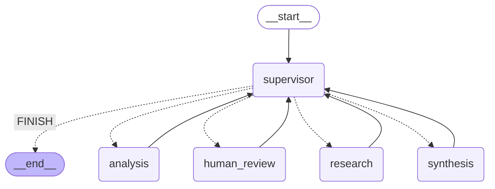

# Localization QA Intelligence System

Sistema de control de calidad para contenido localizado. Valida archivos JSON antes de importarlos a un CMS (Sitecore, Umbraco) combinando validaciones deterministas en Python, recuperación de reglas documentadas (RAG) y un grafo multiagente de LangGraph con Supervisor, persistencia en Redis y Human-in-the-Loop.

> **Las reglas de `knowledge/` son documentación de demostración con fines educativos.** Fueron redactadas para este proyecto; no son documentación oficial de Sitecore ni de Umbraco.

## 1. Problema que resuelve

Antes de importar contenido traducido a un CMS, los equipos de Localization Engineering suelen validar a mano o con scripts aislados que no conocen las reglas del proyecto. Los problemas típicos son:

- JSON con errores de sintaxis.
- Propiedades obligatorias ausentes o inesperadas.
- Tipos y formatos incorrectos.
- Estructuras distintas entre idiomas.
- Marcadores de posición (`{0}`) o etiquetas HTML alterados en la traducción.
- Incumplimiento de los requisitos del CMS de destino.

## 2. Funcionalidades

- Análisis de uno o varios archivos JSON con informe estructurado: hallazgos `ERROR` / `WARNING` / `INFO` con código, archivo, ruta de la propiedad, regla, fuente documental y recomendación.
- Reglas recuperadas de una base de conocimiento ampliable (agregar un `.md` y reingestar).
- Supervisor que decide la ruta según la solicitud (no hay una secuencia fija).
- Pausa y reanudación con intervención humana (HITL) ante ambigüedad real.
- Conversación con contexto por `thread_id` (preguntar por reglas o por un informe anterior).
- Estado persistente en Redis: sobrevive al reinicio del servidor.
- Trazas en Arize Phoenix: grafo, nodos, RAG, herramientas y llamadas a OpenAI.
- Los archivos analizados nunca se modifican.

## 3. Arquitectura

```text
Cliente ──► FastAPI (async, Pydantic) ──► Grafo LangGraph ──► Checkpointer (Redis)
                                              │
              ┌───────────────┬───────────────┼────────────────┐
         Supervisor      Research        Analysis          Synthesis      (+ human_review)
              │               │               │                │
         OpenAI (opc.)   Retriever ──► Chroma   Herramientas QA   OpenAI (opc.)
                                       (async)  (código Python)
                    Todo instrumentado con OpenTelemetry ──► Phoenix
```

Decisiones clave:

- **El LLM no valida.** Las validaciones, los conteos y el veredicto se calculan en código. El LLM decide rutas, selecciona reglas entre las recuperadas y redacta texto.
- **El RAG manda sobre la validación.** El esquema JSON de cada regla vive en `knowledge/` y se pasa a las herramientas. Editar un documento cambia el resultado sin tocar código (hay una prueba que lo demuestra).
- **Modo determinista.** Con `LLM_MODE=deterministic` todo funciona sin OpenAI (Supervisor por reglas, redacción por plantillas, embeddings por hashing). Es para pruebas, no para producción.
- **Completitud de reglas.** Además de la búsqueda semántica, una vez definido el CMS se incorporan por metadatos todas sus reglas. Así una regla obligatoria no se pierde por quedar fuera del top-k, lo que daría falsos "APTO".

### Diagrama del grafo

Generado con `python -m scripts.exportar_diagrama` a partir del grafo compilado (las líneas punteadas son transiciones condicionales).



Ejemplos de rutas reales (verificadas en `tests/unit/test_escenarios.py`):

| Solicitud | Recorrido |
|---|---|
| Analizar archivos con CMS conocido | supervisor → research → analysis → synthesis → fin |
| "Solo validar sintaxis" | supervisor → analysis → synthesis (sin research) |
| Estructura que no permite deducir el CMS | … → analysis → **human_review** (pausa) → analysis → synthesis |
| "¿Qué exige Umbraco…?" | supervisor → research → synthesis (sin analysis) |
| "Explicame el informe" | supervisor → synthesis (usa el informe del thread) |

## 4. Agentes

El estado compartido es un `TypedDict` (`app/graph/state.py`) con valores JSON-serializables; cada campo documenta qué nodo lo escribe.

| Nodo | Responsabilidad | Qué hace el LLM | Qué hace el código |
|---|---|---|---|
| **supervisor** | Interpreta la solicitud, decide el siguiente agente, controla el fin | Propone un `SupervisorDecision` estructurado (intención, alcance, siguiente, razón) | Valida la decisión contra el estado y la reemplaza si es imposible; límite de pasos; modo por reglas sin LLM |
| **research** | Recupera reglas y guías con sus fuentes | Elige qué reglas recuperadas aplican | Descarta ids que no fueron recuperados; completa las reglas del CMS por metadatos |
| **analysis** | Decide comprobaciones y ejecuta las herramientas | Acota el plan si hay instrucción libre; redacta observaciones | Ejecuta todas las herramientas (en hilos, con spans); aplica la política de reglas y HITL |
| **human_review** | Pausa con `interrupt()` y reanuda con la decisión | Nada | Valida la respuesta; si no contesta la pregunta, vuelve a preguntar |
| **synthesis** | Consolida, deduplica, clasifica y redacta | Redacta resumen y acciones correctivas | Conteos, severidades, veredicto `APTO` / `NO_APTO` / `INCOMPLETO` |

### Human-in-the-Loop

La política (`app/agents/politica.py`) resuelve lo que puede resolver sin molestar al usuario:

1. Si la solicitud indica `cms_destino`, se usa.
2. Si no, se infiere por estructura: se elige el CMS cuyas propiedades raíz obligatorias están en todos los archivos.
3. Solo si eso no alcanza se pausa con `cms_ambiguo`.
4. Si hay reglas opcionales aplicables y la solicitud no define `aplicar_reglas_opcionales`, se pausa con `regla_opcional`.
5. Si ningún archivo tiene JSON válido, no se consulta nada: no hay qué validar.

## 5. Sistema RAG

- **Documentos:** `knowledge/reglas/` (generales), `knowledge/cms/` (Sitecore y Umbraco de demostración), `knowledge/ejemplos/` (estructuras y errores). Todos declaran `origen: demostracion_educativa`.
- **Formato:** encabezado YAML + una sección `## REGLA <ID> — <título>` por regla, con `aplicabilidad`, `severidad`, `verificacion` y, opcionalmente, un bloque ` ```json-schema `.
- **Ingestión** (`app/rag/ingestion.py`, `scripts/ingest.py`): lee los `.md`, fragmenta (una regla = un fragmento atómico; las guías se dividen por tamaño), calcula embeddings y hace `upsert` (idempotente) en Chroma. Los documentos mal formados fallan con un mensaje claro.
- **Metadatos por fragmento:** `doc_id`, `ruta`, `seccion`, `cms`, `tipo`, `rule_id`, `aplicabilidad`, `severidad`, `verificacion`, `origen` y el esquema JSON.
- **Recuperación** (`app/rag/retriever.py`): búsqueda por similitud con filtro opcional por CMS (siempre incluye las reglas genéricas) y umbral mínimo. Cada resultado conserva su `FuenteRef` (documento, ruta, `chunk_id`, sección) y el informe cita las fuentes.
- **Vector store:** Chroma en modo servidor con `AsyncHttpClient` (asíncrono). Si se cambia el modelo de embeddings, se usa otra colección para no mezclar vectores.
- **Misma estructura, distintas reglas:** `sitecore_valido.es-AR.json` es `APTO` para Sitecore y `NO_APTO` para Umbraco (faltan `key`, `culture`, `contentType`, `properties`). Ver `knowledge/ejemplos/` y la prueba 5.

## 6. Herramientas de QA

Viven en `app/tools/`, son independientes de los agentes, sus argumentos y resultados son modelos Pydantic y no modifican los datos.

| Herramienta | Códigos | Qué detecta |
|---|---|---|
| `validar_sintaxis_json` | QA-SYN-001/002/003 | JSON inválido (con línea y columna), archivo vacío, claves duplicadas |
| `validar_contra_esquema` | QA-SCH-001/000 | Incumplimiento de JSON Schema (pattern, longitud, enum…) |
| `detectar_propiedades_faltantes` | QA-REQ-001 | Propiedades obligatorias ausentes |
| `detectar_propiedades_inesperadas` | QA-PROP-001 | Propiedades no declaradas |
| `validar_tipos` | QA-TYPE-001 | Tipo esperado vs. encontrado |
| `comparar_estructuras` | QA-STR-001/002/003/004 | Rutas solo en uno de los archivos, tipos distintos, listas de distinta longitud |
| `detectar_inconsistencias_idiomas` | QA-LANG-002…008 | Valores vacíos, marcadores y etiquetas alterados, idioma declarado ≠ nombre, idiomas repetidos |

Una regla `WARNING` nunca produce hallazgos `ERROR`: la severidad de la regla actúa como tope.

## 7. Tecnologías

Python 3.12+, FastAPI, Pydantic v2, LangGraph, `langgraph-checkpoint-redis` (`AsyncRedisSaver`), OpenAI (SDK asíncrono), Chroma, Redis 8, `jsonschema`, OpenTelemetry + OpenInference + Arize Phoenix, pytest, Docker Compose. Versiones fijadas en `requirements.txt`.

LangChain se usa solo a través de `langchain-core` (dependencia de LangGraph). No se usa `langchain-openai`: el SDK de OpenAI se llama directamente, lo que mantiene el cliente desacoplado (`app/services/llm.py`).

## 8. Estructura del repositorio

```text
app/
  api/            rutas, errores, servicio entre API y grafo
  agents/         supervisor, research, analysis, synthesis, human_review, politica
  graph/          estado tipado, construcción del grafo, entradas por tipo de turno
  rag/            ingestion, retriever, embeddings, store (Chroma / memoria)
  tools/          herramientas de QA deterministas
  models/         modelos Pydantic (solicitud, hallazgos, reglas, ejecución, API)
  services/       cliente LLM (OpenAI) desacoplado
  persistence/    checkpointer de Redis
  observability/  configuración de Phoenix y spans manuales
  config/         settings centralizados
  main.py
knowledge/        reglas/ cms/ ejemplos/   (documentación de demostración)
scripts/          ingest.py, escenarios_demo.py, carga_concurrente.py, exportar_diagrama.py
tests/            unit/ integration/ fixtures/
resultados/       resultados reales de la prueba de concurrencia
```

## 9. Requisitos previos

- Docker 24+ con Docker Compose v2.
- Una clave de OpenAI (`OPENAI_API_KEY`), salvo que se use el modo determinista.
- Para ejecutar fuera de Docker: Python 3.12+.

## 10. Instalación y configuración

```bash
git clone <repositorio> && cd localization-qa-intelligence
cp .env.example .env        # editar OPENAI_API_KEY
```

Variables principales de `.env` (todas documentadas en `.env.example`):

| Variable | Descripción |
|---|---|
| `LLM_MODE` | `openai` o `deterministic` |
| `OPENAI_API_KEY`, `OPENAI_MODEL`, `OPENAI_EMBEDDING_MODEL` | Credenciales y modelos |
| `REDIS_URL` | Redis con RediSearch y RedisJSON (Redis 8 o Redis Stack) |
| `CHROMA_HOST`, `CHROMA_PORT`, `CHROMA_COLLECTION`, `VECTOR_STORE_PATH` | Vector store |
| `RAG_TOP_K`, `RAG_MIN_SCORE`, `RAG_CHUNK_MAX_CHARS` | Parámetros de recuperación |
| `MAX_FILES_PER_REQUEST`, `MAX_FILE_SIZE_BYTES`, `GRAPH_MAX_STEPS` | Límites de ejecución |
| `TRACING_ENABLED`, `PHOENIX_COLLECTOR_ENDPOINT`, `PHOENIX_PROJECT_NAME` | Observabilidad |

## 11. Ejecución con Docker Compose

```bash
docker compose up --build
```

Inicia `redis`, `chroma`, `ingesta` (tarea única que carga `knowledge/`), `phoenix` y `api`, con healthchecks y dependencias de arranque.

- API y Swagger UI: <http://localhost:8000/docs>
- Phoenix: <http://localhost:6006>

Sin OpenAI: poner `LLM_MODE=deterministic` en `.env`.

Para volver a ingerir tras editar `knowledge/`: `docker compose run --rm ingesta`.

## 12. Uso de la API

| Endpoint | Función |
|---|---|
| `POST /analyze` | Analiza uno o varios archivos (`multipart/form-data`) |
| `POST /chat` | Pregunta usando el contexto del thread |
| `POST /resume` | Reanuda una ejecución pausada por HITL |
| `GET /threads/{thread_id}/history` | Mensajes, informe, estado y checkpoints |
| `GET /health` | Estado de Redis, Chroma, Phoenix y OpenAI (503 si algo falla) |

Los errores tienen siempre la forma `{"codigo", "mensaje", "detalle"}`. `409` si el thread está pausado, `404` si no existe, `422` si la solicitud es inválida.

### Ejemplos

Análisis con CMS conocido:

```bash
curl -F "archivos=@tests/fixtures/sitecore_valido.es-AR.json" \
     -F "archivos=@tests/fixtures/sitecore_fr_inconsistente.fr-FR.json" \
     -F cms_destino=sitecore -F aplicar_reglas_opcionales=true \
     -F idioma_origen=es-AR -F thread_id=demo-1 \
     http://localhost:8000/analyze
```

Parámetros de `/analyze`: `archivos` (obligatorio), `thread_id`, `instruccion`, `cms_destino`, `idioma_origen`, `aplicar_reglas_opcionales`.

Flujo HITL (las respuestas siguientes son salidas reales de la API en modo determinista):

```bash
curl -F "archivos=@tests/fixtures/estructura_ambigua.json" -F thread_id=demo-hitl http://localhost:8000/analyze
```

```json
{
  "thread_id": "demo-hitl",
  "estado": "pendiente_revision",
  "revision": {
    "tipo": "cms_ambiguo",
    "pregunta": "No se indicó el CMS de destino y la estructura de los archivos no permite deducirlo. ¿Con qué reglas de CMS debe validarse el contenido?",
    "opciones": ["sitecore", "umbraco"]
  },
  "pasos": ["supervisor→research", "research(12 reglas, 5 guías)", "supervisor→analysis",
            "analysis→revisión humana (cms_ambiguo)", "supervisor→human_review"]
}
```

```bash
curl -X POST http://localhost:8000/resume -H 'content-type: application/json' \
     -d '{"thread_id":"demo-hitl","decision":{"cms":"umbraco"}}'
```

Con Umbraco elegido hay una regla opcional (UM-004), así que el grafo pausa de nuevo (`"tipo": "regla_opcional"`). Se responde con `{"decision": {"aplicar_opcionales": true}}` y se obtiene el informe:

```json
{
  "estado": "completado",
  "informe": {
    "estado": "NO_APTO",
    "resumen": "Se encontraron 4 error(es) bloqueante(s) y 3 advertencia(s) en 1 archivo(s). No se recomienda importar hasta corregir los errores bloqueantes.",
    "estadisticas": {"total": 7, "errores": 4, "advertencias": 3, "informativos": 0, "apto_para_importar": false},
    "cms_aplicado": "umbraco",
    "reglas_aplicadas": ["GEN-001", "GEN-002", "GEN-003", "UM-001", "UM-002", "UM-003", "UM-004"],
    "bloqueantes": [{
      "codigo": "QA-REQ-001", "severidad": "ERROR", "archivo": "estructura_ambigua.json",
      "ruta": "$.contentType", "descripcion": "Falta la propiedad obligatoria 'contentType'.",
      "regla": "UM-001", "fuente": "cms/umbraco-demo.md",
      "recomendacion": "Agregar la propiedad 'contentType' en $ según la regla documentada."
    }]
  }
}
```

Chat con contexto y consulta de historial:

```bash
curl -X POST http://localhost:8000/chat -H 'content-type: application/json' \
     -d '{"thread_id":"demo-hitl","mensaje":"Explicame el informe"}'
curl http://localhost:8000/threads/demo-hitl/history
```

## 13. Ejecución de pruebas

```bash
pip install -r requirements-dev.txt
pytest                                  # unitarias; las de integración se omiten si falta el servicio
```

Integración con Redis y Chroma reales (levantar `docker compose up -d redis chroma ingesta`):

```bash
TEST_REDIS_URL=redis://localhost:6379 TEST_CHROMA_PORT=8001 pytest
```

Integración con OpenAI (consume pocos tokens):

```bash
OPENAI_API_KEY=sk-... pytest -m openai -v
```

Cobertura de la batería:

- **Cinco escenarios obligatorios** (`tests/unit/test_escenarios.py`): JSON válido, JSON inválido, propiedades faltantes, inconsistencia estructural, RAG contextual (incluye la prueba de que editar la documentación cambia el resultado).
- Modelos Pydantic, herramientas de QA, RAG, política de reglas, Supervisor (transiciones válidas e inválidas, con y sin LLM simulado), grafo, recuperación de estado, HITL (pausa, reanudación, doble pausa, respuesta inválida), manejo de excepciones, API (incluye 5 solicitudes simultáneas) y persistencia en Redis.
- Los LLM se simulan con `tests/unit/fakes.py` para no consumir tokens.

### Los 5 escenarios contra el sistema en ejecución (con trazas)

Además de pytest, `scripts/escenarios_demo.py` ejecuta los 5 escenarios funcionales (JSON válido, JSON inválido, propiedades faltantes, inconsistencia estructural y RAG contextual) contra la API real. Cada uno genera una traza en Phoenix, identificable por su `thread_id` (`escenario-N-<sufijo>`):

```bash
docker compose cp tests api:/srv/app/tests
docker compose exec api python -m scripts.escenarios_demo --url http://localhost:8000
```

## 14. Verificación de persistencia

Automática (Redis con RediSearch y RedisJSON): `pytest tests/integration/test_persistencia_redis.py`. Crea una aplicación, inicia un análisis que queda pausado, descarta esa aplicación, crea otra sobre el mismo Redis, recupera el historial, reanuda con `/resume` y, en una tercera instancia, consulta el informe final.

Manual:

```bash
curl -F "archivos=@tests/fixtures/estructura_ambigua.json" -F thread_id=persist-1 http://localhost:8000/analyze
docker compose restart api
curl http://localhost:8000/threads/persist-1/history      # sigue "pendiente_revision"
curl -X POST http://localhost:8000/resume -H 'content-type: application/json' \
     -d '{"thread_id":"persist-1","decision":{"cms":"sitecore"}}'
```

## 15. Verificación de observabilidad

1. Con `docker compose up`, abrir <http://localhost:6006> y entrar al proyecto `localization-qa`.
2. Generar una ejecución con el `curl` de `/analyze` de arriba.
3. En *Traces* aparece una traza por solicitud. Spans esperados:

| Tipo | Spans |
|---|---|
| Grafo (LangChain/LangGraph) | `LangGraph`, un span por nodo (`supervisor`, `research`, `analysis`, `synthesis`, `human_review`) y `enrutar` por cada transición condicional |
| Agentes (manuales) | `agente.supervisor` (atributos `supervisor.siguiente` e `intencion`), `agente.research`, `agente.analysis`, `agente.synthesis`, `agente.human_review` |
| RAG | `rag.recuperar` (consulta, documentos y puntajes) y `rag.completar_reglas` |
| Herramientas | `herramienta.validar_sintaxis_json`, `herramienta.validar_contra_esquema`, `herramienta.comparar_estructuras`, … |
| OpenAI (con `LLM_MODE=openai`) | llamadas `ChatCompletion` y de embeddings, con tokens y latencia |
| FastAPI | un span por solicitud HTTP |

Las excepciones quedan registradas en el span correspondiente (cubierto por pruebas con un exportador en memoria; no se provocó un error real para verlo en la interfaz de Phoenix). La pausa HITL no se marca como error: el span `agente.human_review` queda con `hitl.pausado=true` y estado OK.

## 16. Resultados de las pruebas

Ejecutadas en el entorno de desarrollo, con Redis 8.2.1 compilado con RediSearch y RedisJSON, Chroma 1.5.9 en modo servidor y Phoenix 21.0.0.

| Ejecución | Resultado |
|---|---|
| `pytest` completo, Python 3.13.18 | **127 pasaron, 1 omitida** |
| `pytest` completo, Python 3.12.16 | **127 pasaron, 1 omitida** |
| Prueba omitida | `test_openai_real.py`: no hay acceso a `api.openai.com` desde el entorno de desarrollo |
| `ruff check` y `ruff format --check` | Sin errores |

Las 6 pruebas de integración con Redis y Chroma reales se ejecutaron y pasaron. Sin esos servicios se omiten.

### Prueba de concurrencia (5 solicitudes simultáneas)

`python -m scripts.carga_concurrente --url http://localhost:8000 --solicitudes 5`. El detalle de cada corrida queda en `resultados/`. El p95 usa rango más cercano; con 5 muestras coincide con la latencia máxima.

**Con OpenAI real** (`LLM_MODE=openai`, desplegado con Docker Compose, script ejecutado dentro del contenedor de la API con `docker compose exec`):

| Solicitudes | Completadas | Errores | Tiempo total | Latencia promedio | Latencia p95 | Mín. / Máx. |
|---:|---:|---:|---:|---:|---:|---|
| 5 | 5 | 0 | 9,591 s | 8,453 s | 9,590 s | 7,227 s / 9,590 s |

Las 5 solicitudes se resolvieron en paralelo: el tiempo total (9,6 s) es similar al de una sola solicitud con OpenAI (10,6 s en la traza de Phoenix), no cinco veces mayor.

**Modo determinista** (`LLM_MODE=deterministic`, sin latencia de OpenAI; entorno de desarrollo, API con uvicorn, Redis y Chroma reales). Mide la API, el grafo, Redis, Chroma y las herramientas:

| Corrida | Solicitudes | Completadas | Errores | Tiempo total | Latencia promedio | Latencia p95 |
|---|---:|---:|---:|---:|---:|---:|
| 1 | 5 | 5 | 0 | 0,315 s | 0,298 s | 0,313 s |
| 2 | 5 | 5 | 0 | 0,327 s | 0,310 s | 0,326 s |
| 3 | 5 | 5 | 0 | 0,313 s | 0,303 s | 0,312 s |

### Qué se verificó y qué no

| Componente | Estado |
|---|---|
| Herramientas, RAG, grafo, HITL, API | Verificado con pruebas automáticas (127 pasaron) |
| Checkpointer en Redis y recuperación tras recrear la aplicación | Verificado con la prueba automática y manualmente con Docker (`docker compose restart api`: el thread siguió en `pendiente_revision` con sus checkpoints) |
| Chroma asíncrono sobre HTTP | Verificado con servidor `chroma run` y con el servicio de Docker Compose |
| `docker compose up --build` | Verificado: `redis` (`redis:8.2.1`), `chroma`, `phoenix` y `api` levantan; `ingesta` termina con código 0 |
| Trazas en Phoenix | Verificado: grafo, nodos, agentes, RAG y herramientas |
| Llamadas a OpenAI, embeddings, tokens y costo en Phoenix | Verificado en una traza real de `POST /analyze` (`ChatCompletion`, `CreateEmbeddings`, tokens y costo por llamada) |
| Análisis completo con OpenAI real y concurrencia con OpenAI | Verificado (ver tabla de concurrencia) |
| Prueba automática `pytest -m openai` | **No ejecutada** (el análisis con OpenAI real se verificó manualmente por la API) |
| Excepciones en la interfaz de Phoenix | Cubiertas por pruebas con exportador en memoria; no se provocó un error real para verlo en la interfaz |

## 17. Limitaciones conocidas

- **Phoenix y autenticación.** Si el volumen de Phoenix se creó con autenticación activa, puede pedir login. El `docker-compose.yml` fija `PHOENIX_ENABLE_AUTH: "false"`; si ya hubo un arranque previo con otra configuración, hay que borrar el volumen `phoenix_data` (`docker compose rm -sf phoenix` y `docker volume rm <proyecto>_phoenix_data`).
- **Healthcheck de la API.** `/health` responde 503 si algún componente falla (por ejemplo Phoenix caído), y Docker marca entonces la API como `unhealthy` aunque pueda analizar archivos.
- **Embeddings en modo determinista.** `HashEmbedder` es léxico, no semántico. Es suficiente para pruebas, pero el ranking es peor que con OpenAI. Por eso la completitud de reglas por CMS no depende del ranking.
- **Posición de errores JSON.** Python 3.12 y 3.13 reportan distinta línea para algunos errores (p. ej. coma sobrante); es el comportamiento del parser estándar.
- **Concurrencia sobre un mismo thread.** Dos solicitudes simultáneas al mismo `thread_id` no están serializadas. Threads distintos son independientes.
- **Contenido de los archivos en el estado.** Se guarda en el checkpoint de Redis (límites: `MAX_FILES_PER_REQUEST` y `MAX_FILE_SIZE_BYTES`).
- **CPU-bound.** `jsonschema` no tiene versión asíncrona: las herramientas se ejecutan con `asyncio.to_thread`. Archivos muy grandes consumen hilos del pool.
- **Sin autenticación** ni control de acceso en la API.
- **Alcance de las reglas.** Son de demostración y cubren estructuras simplificadas de Sitecore y Umbraco.

## 18. Mejoras futuras

- Serializar ejecuciones concurrentes por `thread_id`.
- Streaming del progreso del grafo (SSE).
- Evaluaciones de calidad del RAG con embeddings reales.
- Más tipos de revisión humana (por ejemplo, aprobar el informe final).
- Autenticación y almacenamiento de archivos fuera del estado.
- Otro proveedor de LLM implementando `LLMClient`.
